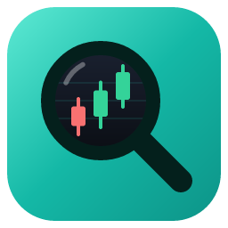
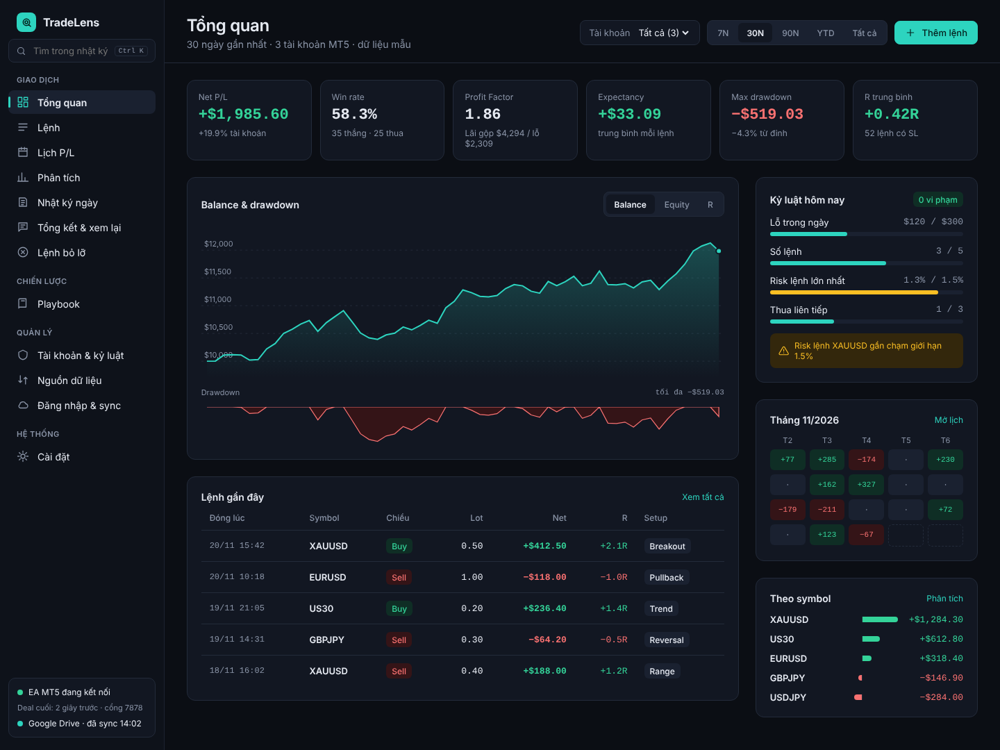
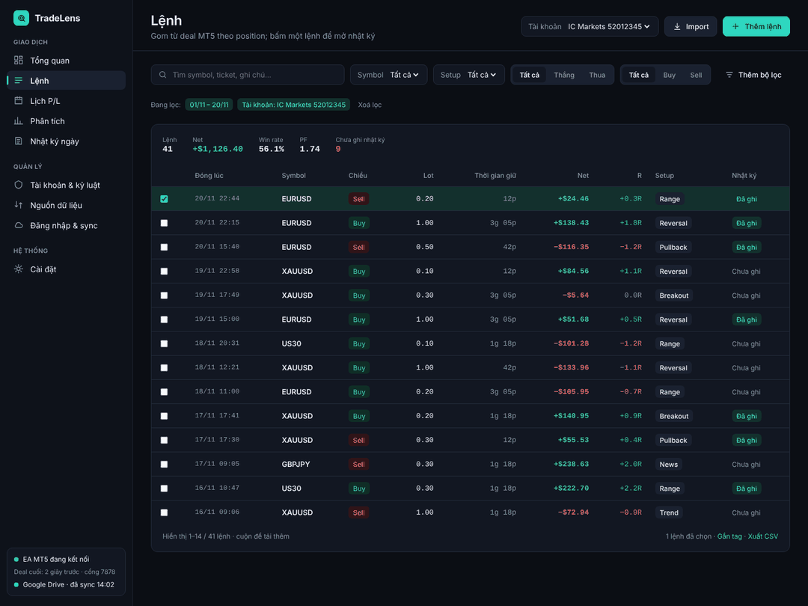
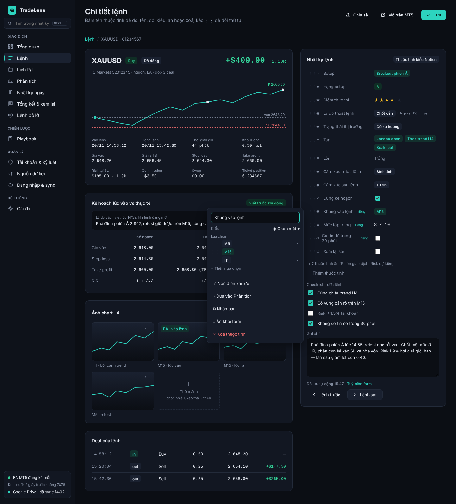
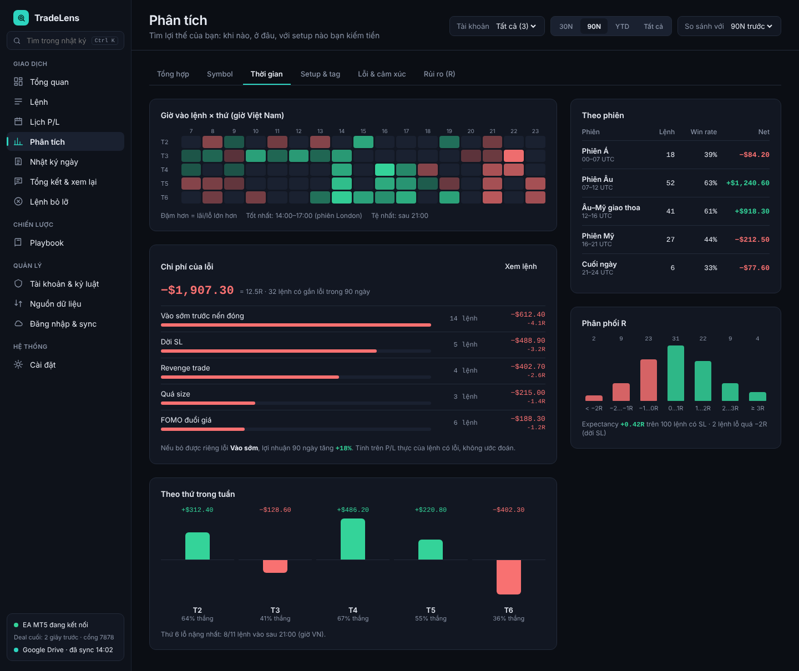
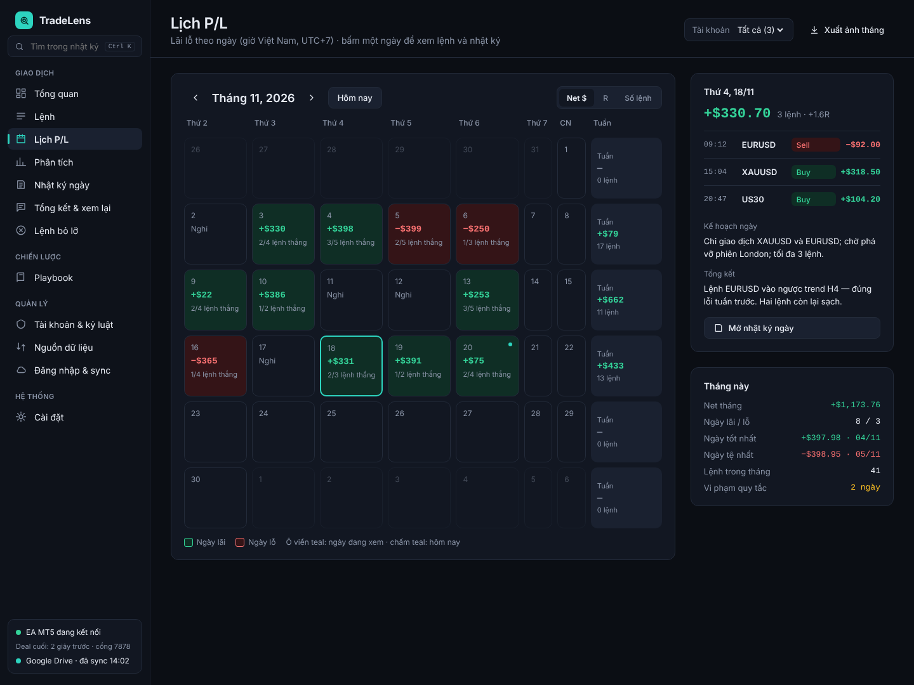
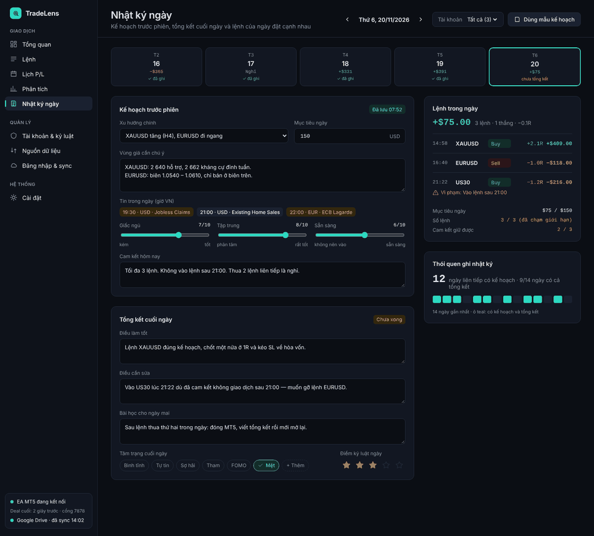
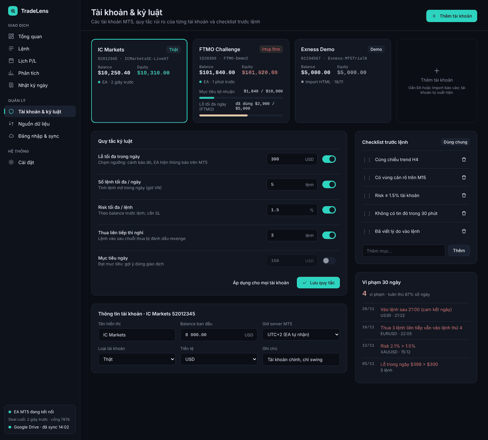

  

<h1 align="center">TradeLens</h1>

  <b>Nhật ký giao dịch cho trader MetaTrader 5</b> 
  <b>A trading journal for MetaTrader 5 traders</b>

  <a href="https://github.com/DEVfancybear/tradelens/releases/latest/download/TradeLens-setup.exe">Tải cho Windows / Download for Windows</a> ·
  <a href="https://github.com/DEVfancybear/tradelens/releases">Phiên bản / Releases</a> ·
  <a href="https://devfancybear.github.io/tradelens/">Trang giới thiệu / Website</a>

  <a href="#tiếng-việt">Tiếng Việt</a> · <a href="#english">English</a>

  

---

## Tiếng Việt

TradeLens tự lấy lệnh từ tài khoản MT5, gom thành từng giao dịch, tính thống kê và giúp bạn ghi lại vì sao vào lệnh,
đã làm đúng kế hoạch chưa, và rút ra bài học gì. Mục tiêu là biến lịch sử giao dịch thành thứ bạn có thể học từ đó,
thay vì chỉ là một bảng số.

App chạy trên máy tính (Windows), dữ liệu nằm trên máy của bạn, có thể đồng bộ qua Google Drive hoặc OneDrive của
chính bạn. Giao diện tiếng Việt và tiếng Anh.

### Lệnh tự vào nhật ký

- **Kết nối MT5 ngay trong app**: nhập số tài khoản, mật khẩu và server; lệnh đã đóng hiện trong nhật ký sau vài giây,
  không cần mở MetaTrader hay cài EA. Theo dõi nhiều tài khoản cùng lúc.
- **Hoặc import báo cáo** MT5 (HTML, XLSX) bằng cách kéo thả, và chuyển nhật ký cũ từ **Notion** sang.
- **Nhập tay** lệnh và nhật ký khi cần.
- **Quản lý lệnh đang mở**: sửa SL/TP, đóng toàn bộ hoặc một phần ngay trong app.

### Hiểu mình giao dịch thế nào

- **Tổng quan**: lợi nhuận, tỉ lệ thắng, profit factor, kỳ vọng, đường equity và drawdown.
- **Lịch P/L**: kết quả từng ngày trong tháng, bấm vào một ngày để xem các lệnh của ngày đó.
- **Phân tích** theo symbol, setup, tag, phiên, giờ, chiều Buy/Sell, cảm xúc và lỗi hay mắc; mỗi dòng mở thẳng ra các
  lệnh tạo nên nó.
- **Tìm kiếm** toàn văn qua lệnh, ghi chú và nhật ký.

### Ghi nhật ký có chiều sâu

- **Kế hoạch lúc vào vs thực tế**: khi có lệnh mới, app hỏi kế hoạch (lý do vào, SL/TP dự kiến); sau đó so với cách
  lệnh thực sự diễn ra.
- **Nhật ký từng lệnh**: setup, hạng setup, điểm thực thi, cảm xúc, lý do thoát, lỗi mắc phải và cái giá của lỗi đó,
  kèm nhiều ảnh chart.
- **Form tuỳ biến** kiểu Notion: tự thêm trường bạn muốn theo dõi.
- **Nhật ký ngày**, **tổng kết tuần/tháng** với hàng chờ những lệnh chưa xem lại, và mẫu ghi chú dùng lại được.
- **Playbook**: mô tả từng setup của bạn và xem setup nào thực sự hiệu quả.
- **Lệnh bỏ lỡ**: ghi lại cơ hội đã thấy mà không vào, để biết mình bỏ qua bao nhiêu.

### Giữ kỷ luật

- **Quy tắc riêng cho từng tài khoản** (lỗ tối đa trong ngày, số lệnh tối đa trong ngày, rủi ro mỗi lệnh, chuỗi thua
  liên tiếp), app đánh dấu khi vi phạm.
- **Checklist trước khi vào lệnh** và thẻ "Kỷ luật hôm nay".
- **Tin quan trọng**: tin đỏ trong tuần và đếm ngược tới tin kế tiếp, để không vào lệnh ngay trước tin lớn.

### Đồng bộ và chia sẻ

- **Đồng bộ nhiều máy** qua Google Drive hoặc OneDrive của bạn: tự động định kỳ và khi đóng app, sửa trên hai máy cùng
  lúc không mất dữ liệu; khôi phục toàn bộ sang máy mới.
- **Thẻ chia sẻ kết quả** (có thể ẩn số tiền, chỉ hiện R) và **báo cáo PDF** theo tháng.

### Quyền riêng tư

- Dữ liệu giao dịch và nhật ký nằm trên máy của bạn; khi bật đồng bộ, chúng chỉ đi tới Google Drive hoặc OneDrive của
  chính bạn.
- Mật khẩu MT5 được giữ trong trình quản lý mật khẩu của Windows, không lưu dạng chữ thường.
- Xem thêm [Chính sách quyền riêng tư](docs/privacy.md) và [Điều khoản sử dụng](docs/terms.md).

### Cài đặt

- Windows 10/11, 64-bit. Tải bộ cài ở trên và chạy.
- Bộ cài chưa ký số: nếu Windows SmartScreen cảnh báo, chọn **Thông tin thêm** → **Vẫn chạy**.
- App tự kiểm tra và tải bản mới, cài khi khởi động lại (có thể tắt trong Cài đặt).
- Muốn kết nối MT5 trực tiếp thì máy cần MetaTrader 5; những thành phần còn thiếu app tự cài giúp bạn, không cần quyền
  quản trị.

---

## English

TradeLens pulls your trades straight from your MT5 accounts, groups them into trades, computes your statistics, and
helps you write down why you entered, whether you followed your plan, and what you learned. The aim is to turn your
trading history into something you can learn from, not just a table of numbers.

It is a desktop app (Windows). Your data stays on your computer and can sync through your own Google Drive or
OneDrive. The interface is in English and Vietnamese.

### Trades land in your journal on their own

- **Connect MT5 inside the app**: enter your account number, password and server; closed trades show up in your journal
  within seconds, with no MetaTrader window to keep open and no EA to install. Follow several accounts at once.
- **Or import** MT5 reports (HTML, XLSX) by drag and drop, and bring an existing journal over from **Notion**.
- **Enter trades by hand** when you need to.
- **Manage open positions**: move SL/TP, close all or part of a position from the app.

### See how you really trade

- **Overview**: net profit, win rate, profit factor, expectancy, equity curve and drawdown.
- **P/L calendar**: each day of the month at a glance; click a day to see its trades.
- **Analytics** by symbol, setup, tag, session, hour, direction, emotion and recurring mistakes; every row opens the
  trades behind it.
- **Full-text search** across trades, notes and journals.

### Journal with depth

- **Plan vs. reality**: when a new trade opens, the app asks for your plan (reason, intended SL/TP), then compares it
  with how the trade actually played out.
- **Per-trade journal**: setup, setup grade, execution score, emotions, exit reason, mistakes and what they cost, plus
  several chart screenshots.
- **Custom forms**, Notion-style: add the fields you want to track.
- **Daily journal**, **weekly and monthly reviews** with a queue of trades still to review, and reusable note templates.
- **Playbook**: describe each of your setups and see which ones actually work.
- **Missed trades**: log the opportunities you saw but did not take, to know what you leave on the table.

### Stay disciplined

- **Rules per account** (daily loss limit, daily trade limit, risk per trade, losing streak); the app flags every
  breach.
- **Pre-trade checklist** and a "Discipline today" card.
- **High-impact news**: this week's red-folder events with a countdown to the next one, so you don't walk into a big
  release.

### Sync and share

- **Sync across computers** through your own Google Drive or OneDrive: automatically on a schedule and when you close
  the app; edits made on two machines at once are merged without losing data; restore everything on a new computer.
- **Share cards** (amounts can be hidden to show only R) and a **monthly PDF report**.

### Privacy

- Your trades and journal stay on your computer; when sync is on, they go only to your own Google Drive or OneDrive.
- Your MT5 password is kept in the Windows credential store, never in plain text.
- See the [Privacy policy](docs/privacy.md) and [Terms of use](docs/terms.md) (in Vietnamese).

### Install

- Windows 10/11, 64-bit. Download the installer above and run it.
- The installer is not code-signed yet: if Windows SmartScreen warns you, choose **More info** → **Run anyway**.
- The app checks for and downloads new versions on its own and installs them on restart (you can turn this off in
  Settings).
- Connecting MT5 directly needs MetaTrader 5 on the computer; the app installs whatever else is missing for you, without
  admin rights.

---

## Ảnh chụp / Screenshots

**Lệnh / Trades**

**Chi tiết lệnh và nhật ký / Trade detail and journal**

**Phân tích / Analytics**

**Lịch P/L / P/L calendar**

**Nhật ký ngày / Daily journal**

**Tài khoản & kỷ luật / Accounts and discipline**

## Giấy phép / License

[MIT](LICENSE) © 2026 DEVfancybear
